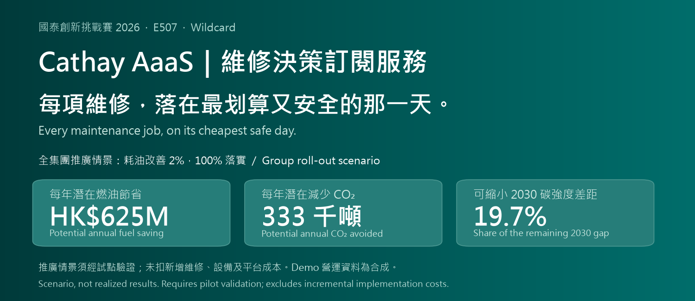
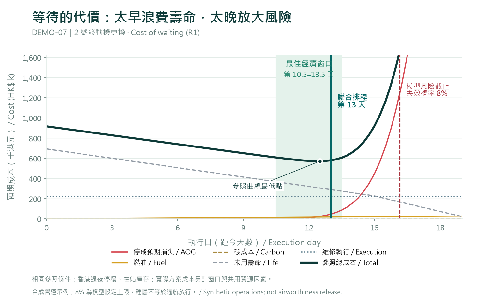
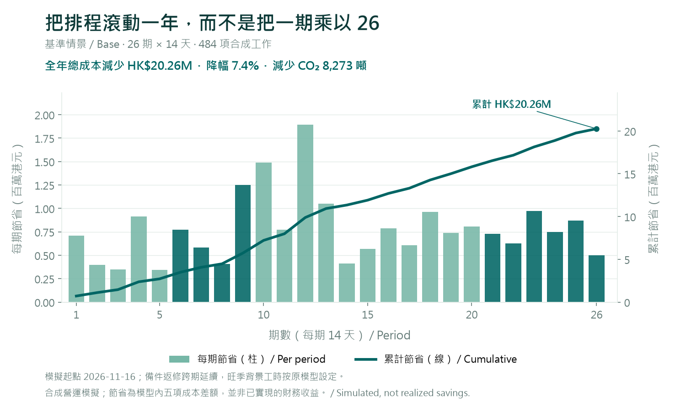
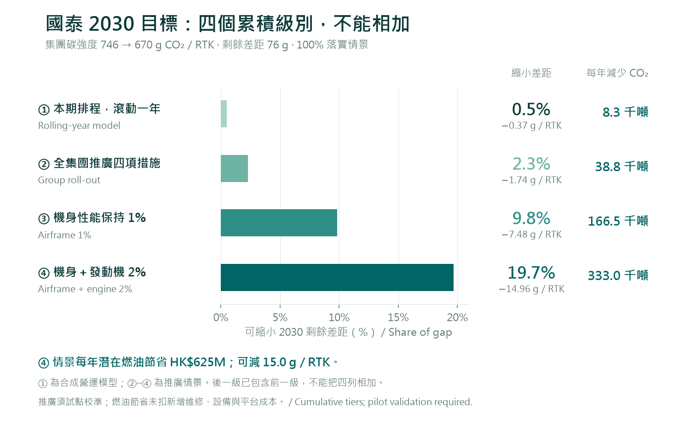
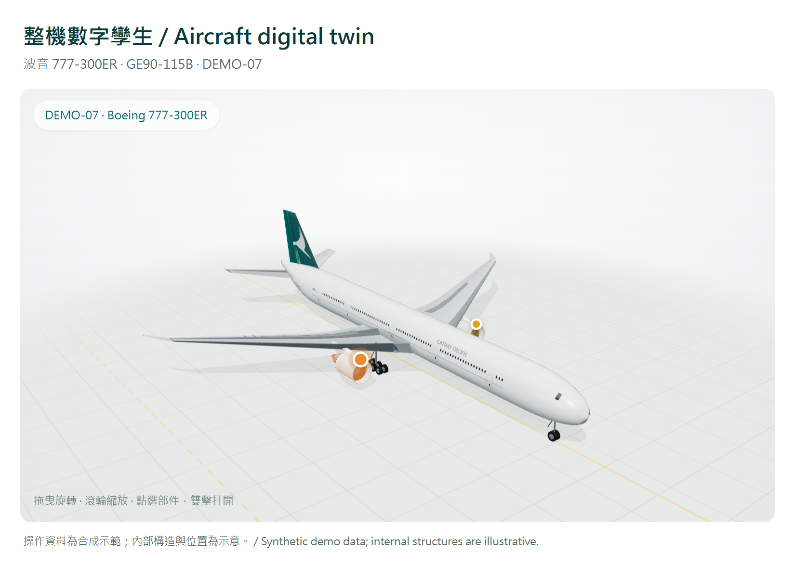
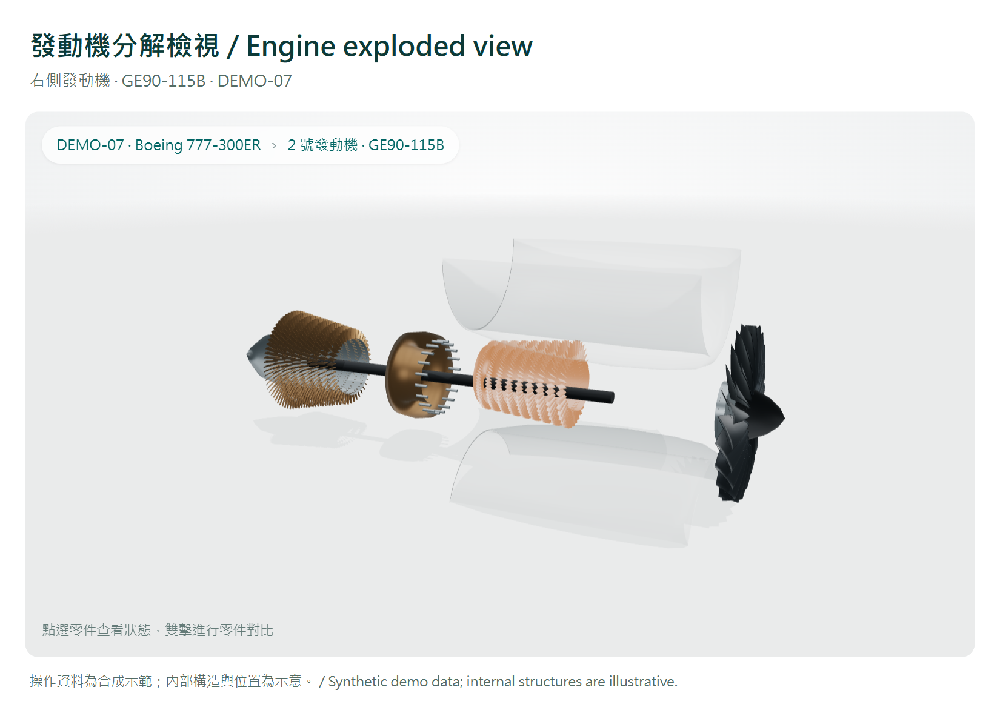
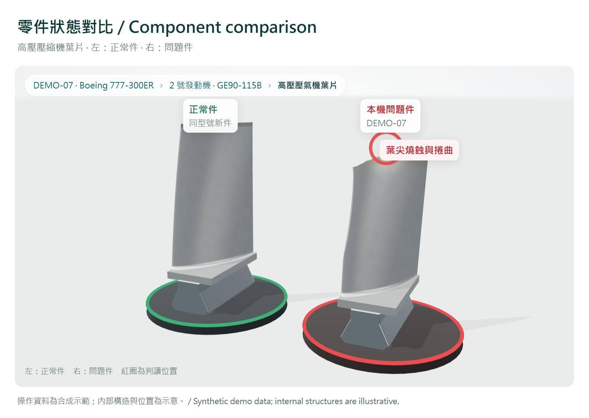
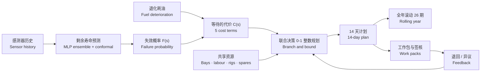

# Cathay AaaS · 维修决策订阅服务 / MRO decision-as-a-service

[](https://github.com/shentonyan/Cathay-Hackathon-2026-TeamE507/actions/workflows/ci.yml)
[](https://shentonyan.github.io/Cathay-Hackathon-2026-TeamE507/)


持續整合（CI） · 網站部署（Pages） · 執行與復現環境（Node / Python） · 自選題賽道（Wildcard）。



**每项维修，落在最划算又安全的那一天。 / Every maintenance job, on its cheapest safe day.**

Team E507 FastenUrSeatBelt 把国泰的维修决策能力做成可订阅的服务：先预测部件还能用多久，再为每项工作计算「等待的代价」，最后在机库、人手、设备与备件的共同限制下，为整个机队一起排程。国泰是首个租户，其他航空公司以同一方式订阅。

Team E507 FastenUrSeatBelt turns Cathay's maintenance decision capability into a subscription service: predict remaining useful life, price the cost of waiting for every job, then schedule the whole fleet jointly under shared hangar, labour, tooling and spare-part limits. Cathay is the first tenant; other airlines subscribe the same way.

<p align="center">
  <a href="https://shentonyan.github.io/Cathay-Hackathon-2026-TeamE507/"><b>▶ 在线 Demo / Live demo</b></a> ·
  <a href="docs/DEMO.md">演示手册 / Demo runbook</a> ·
  <a href="docs/MODEL.md">数学模型 / Model</a> ·
  <a href="docs/DATA.md">数据来源 / Data</a> ·
  <a href="docs/REPRODUCE.md">复现 / Reproduce</a>
</p>

| 身份 / Role           | 账户 / Account                               | 密码 / Password | 可见内容 / Sees                        |
| --------------------- | -------------------------------------------- | --------------- | -------------------------------------- |
| 管理人员 / Planner    | `demo2`                                      | `demo`          | 全部 6 个页面 / All 6 pages            |
| 维修员工 / Engineer   | `demo1`                                      | `demo`          | 工作包与数字孪生 / Work packs and twin |
| 外部公司 / Subscriber | 模拟订阅后的电邮 / Email after mock checkout | `demo`          | 企业工作空间 / Tenant workspace        |

登录只在浏览器本地模拟，没有真实账户系统或付款。 / Sign-in and checkout are simulated in the browser; there is no real identity system or payment.

## 一眼看懂 / At a glance

| 指标 / Metric                                       | 数值 / Value                  | 性质 / Nature                                                     |
| --------------------------------------------------- | ----------------------------- | ----------------------------------------------------------------- |
| 全年滚动模拟节省 / Rolling-year saving              | **HK\$20.3M**（−7.4%）        | 模型计算：26 期 × 14 天，484 项工作 / Model: 26 periods, 484 jobs |
| 全年减少 CO₂ / CO₂ avoided per year                 | **8,273 t**                   | 同上 / Same simulation                                            |
| 全年最高失效概率 / Max failure probability          | **3.0%**（上限 8%）           | 同上 / Same simulation                                            |
| 剩余寿命预测误差 / RUL error                        | **10.65 cycles** RMSE         | NASA C-MAPSS FD001 测试集 / Test set                              |
| 推广后完成 2030 减碳差距 / Share of 2030 gap closed | **19.7%**（15.0 g/RTK）       | 推广情景，需试点验证 / Scenario, needs pilot                      |
| 推广后每年燃油节省 / Fuel saved per year            | **HK\$625M** · **333K t CO₂** | 推广情景，需试点验证 / Scenario, needs pilot                      |

## 为什么是联合决策 / Why a joint decision

维修做得太早，浪费零件剩余寿命；做得太晚，停飞风险与退化燃油急升。每项工作都有一条 U 形的「等待的代价」曲线。可是各自挑最便宜的日子，会在同一天争用同一套清洗设备、机库位和备用发动机：第 1 期的「逐项最优」看似只要 HK\$4.37M，实际有 **6 处资源冲突**，做不到。

Too early wastes remaining part life; too late multiplies AOG risk and deteriorated fuel burn. Every job has a U-shaped cost-of-waiting curve. Yet if each job picks its own cheapest day, they collide on the same wash rigs, hangar bays and spare engines: in period 1 the per-job optimum looks like HK\$4.37M but has **6 resource conflicts** and cannot be executed.



| 排法 / Approach                                 | 第 1 期成本 / Period-1 cost | 可行 / Feasible                  |
| ----------------------------------------------- | --------------------------- | -------------------------------- |
| 现行做法：固定门槛、先到先得 / Current practice | HK\$7.30M                   | ✓                                |
| 逐项最优 / Per-job optimum                      | HK\$4.37M                   | ✕ 6 处冲突 / 6 conflicts         |
| **联合决策 / Joint decision**                   | **HK\$6.59M**               | ✓ 全部约束满足 / all constraints |

## 一年的真实效果 / A year, actually simulated

不是把一期乘以 26。第 1 期是本期 21 项真实排程的工作；之后每期按机队规模产生新工作，备用发动机用掉后约 75 天才修好回库并跨期延续，旺季（1–2 月、8–10 月）其他飞机占用更多工时。现行做法与联合决策各跑完整 26 期再比较。

Not one period × 26. Period 1 is the 21 jobs in the current plan; later periods draw new jobs at fleet-scale rates, spare engines return from shop after ~75 days and carry across periods, and peak seasons consume more background labour. Current practice and the joint decision each run all 26 periods.



| 情景 / Scenario               | 全年节省 / Saving | 降幅 / Δ | 全年减 CO₂ / CO₂ avoided |
| ----------------------------- | ----------------: | -------: | -----------------------: |
| 基准 / Base                   |        HK\$20.26M |     7.4% |                  8,273 t |
| 机库减少一个 / One fewer bay  |        HK\$22.24M |     7.2% |                  8,293 t |
| 减碳优先 / Carbon first       |        HK\$35.32M |    11.3% |                  8,736 t |
| 备用发动机紧张 / Tight spares |        HK\$12.64M |     4.1% |                  8,248 t |

## 帮国泰完成 2030 目标的多少 / How much of Cathay's 2030 target

国泰集团要在 2030 年把碳强度由 746 降到 670 g CO₂/RTK，还差 76 g。维修时机逐级推广，最多可完成约五分之一，而且每减 1 吨 CO₂ 反而节省约 HK\$1,870 燃油。

Cathay Group targets 670 g CO₂/RTK by 2030, 76 g below 2025's 746 g. Rolled out step by step, maintenance timing can close about one fifth of the gap — while saving roughly HK\$1,870 of fuel per tonne of CO₂ avoided.



| 级别 / Tier                                 | 每年减 CO₂ / CO₂ per year | 完成差距 / Gap closed | 性质 / Nature                 |
| ------------------------------------------- | ------------------------: | --------------------: | ----------------------------- |
| ① 本期排程滚动一年 / This plan, rolled 1 yr |                    8.3K t |                  0.5% | 模型计算 / Model              |
| ② 全集团推广四项措施 / Group roll-out       |                   38.8K t |                  2.3% | 文献参数 / Literature         |
| ③ 机身性能保持 1% / Airframe 1%             |                  166.5K t |                  9.8% | Airbus 手册 / Airbus guide    |
| ④ 机身＋发动机 2% / Airframe + engine 2%    |                  333.0K t |                 19.7% | 行业参考 / Industry reference |

后一级已包含前一级，不能相加；②–④须以试点实测校准。 / Each tier contains the previous one; tiers ②–④ must be calibrated with pilot measurements.

## 数字孪生 / Digital twin

按国泰实际机型建模（777-300ER · GE90-115B、777-300 · Trent 892、A350-900/1000 · Trent XWB、A330-300 · Trent 700、A321neo · LEAP-1A）。从整机进入部件，再并排对比正常件与问题件。

Modelled on Cathay's actual types and engines. Drill from aircraft to component, then compare a healthy part with the defective one side by side.

| 整機 / Aircraft                                                                                                                           | 發動機分解 / Engine                                                                                                        |
| ----------------------------------------------------------------------------------------------------------------------------------------- | -------------------------------------------------------------------------------------------------------------------------- |
| [](docs/assets/twin-777-300er.zh-Hant.png) | [](docs/assets/twin-engine.zh-Hant.png) |

[](docs/assets/twin-part-compare.zh-Hant.png)

三幅圖由實際 Demo 的 WebGL 畫面擷取，附中英標題；點圖可放大。尺寸依製造商公開規格，內部結構為示意，操作資料為合成。 / Captured from the live WebGL demo with bilingual headings; click to enlarge. Dimensions follow public manufacturer specs; internals are illustrative and operational data is synthetic.

圖表以目前程式中的基準情景與推廣參數重新產生；重繪指引見[配圖工具 / Figure tools](scripts/docs/README.md)。 / Charts use the current base scenario and roll-out parameters; see the figure guide.

## 怎样运作 / How it works



| 环节 / Stage                 | 算法 / Algorithm                                                                                                           | 位置 / Code                                                |
| ---------------------------- | -------------------------------------------------------------------------------------------------------------------------- | ---------------------------------------------------------- |
| 剩余寿命 / RUL               | 多层感知器集成（15 = 5 折 × 3 种子，128-64 ReLU）＋分箱交叉共形 90% 区间 / MLP ensemble + binned cross-conformal intervals | [experiments/rul-cmapss](experiments/rul-cmapss/README.md) |
| 特征 / Features              | 14 个感测器的指数平滑（α = 0.03/0.08/0.20）与 20/60 循环滚动斜率，共 71 维 / EWM + rolling slopes, 71 features             | [train_rul.py](experiments/rul-cmapss/train_rul.py)        |
| 等待的代价 / Cost of waiting | 停飞风险、燃油、碳、浪费的寿命、维修执行逐日叠加 / Five-term daily cost curve                                              | [joint-model.js](site/assets/js/joint-model.js)            |
| 联合排程 / Joint scheduling  | 0-1 整数规划，精确分支定界（下界剪枝）/ Binary integer program, exact branch and bound                                     | [joint-model.js](site/assets/js/joint-model.js)            |
| 全年滚动 / Rolling year      | 26 期序贯求解，备件库存跨期延续 / Sequential solves with carried-over spares                                               | [rolling-sim.js](site/assets/js/rolling-sim.js)            |

全部 25 条公式、89 个符号与参数见 [数学模型 / Model](docs/MODEL.md)。 / All 25 formulas and 89 symbols are in [the model document](docs/MODEL.md).

## 预测有多准 / How accurate is the prediction

本实验评估前将测试集真实剩余寿命截断至 125 循环。下列文献数字仅供参考，尚未核对各研究的目标截断、预处理与评分流程，不能据此认定同条件下优于其他方法。

This experiment caps test-set ground-truth RUL at 125 cycles before scoring. Literature figures below provide context; target capping, preprocessing and scoring protocols have not been matched across studies, so the table does not establish superiority under the same evaluation conditions.

| 方法（FD001 同一测试集）/ Method (same FD001 test set)                      | RMSE（循环） | NASA 评分 / Score |
| --------------------------------------------------------------------------- | -----------: | ----------------: |
| **本平台：MLP 集成 + 交叉共形 / This repo: MLP ensemble + cross-conformal** |    **10.65** |           **200** |
| 深度卷积网络 DCNN（Li et al., 2018）                                        |        12.61 |               274 |
| 长短期记忆网络 LSTM（Zheng et al., 2017）                                   |        16.14 |               338 |
| 卷积神经网络 CNN（Babu et al., 2016）                                       |        18.45 |              1287 |

90% 区间实际覆盖 88%；剩余 30 循环以内的 25 台发动机覆盖 92%。区间宽度随剩余寿命缩短而收窄（30 循环以内约 ±5.8）。C-MAPSS 为模拟数据，正式使用需以国泰实际发动机监测数据重新训练。

The 90% interval covers 88% of test engines overall and 92% of the 25 engines within 30 cycles of failure, where the half-width is about ±5.8 cycles. C-MAPSS is simulated; production use requires retraining on Cathay's engine-health data.

## 快速开始 / Quick start

只看 Demo：打开 [在线 Demo](https://shentonyan.github.io/Cathay-Hackathon-2026-TeamE507/)，或在本地运行： / To view the demo, open the live link or run locally:

```sh
git clone https://github.com/shentonyan/Cathay-Hackathon-2026-TeamE507.git
cd Cathay-Hackathon-2026-TeamE507
npm ci
npm run site            # http://127.0.0.1:4173
```

复现算法结果： / Reproduce the results:

```sh
npm run reproduce:schedule                      # 4 情景 × 26 期，与 Demo 逐项比对 / compare with demo
python -m pip install -r experiments/rul-cmapss/requirements.txt
python experiments/rul-cmapss/download_data.py  # 下载并校验 SHA-256 / download + verify
python experiments/rul-cmapss/train_rul.py      # RMSE 10.65 · score 200 · PICP 88%
```

完整步骤、耗时与预期输出见 [复现 / Reproduce](docs/REPRODUCE.md)。原有的开发预览仍可用 `npm run dev`。 / See the reproduction guide for runtimes and expected output; the original developer preview still runs with `npm run dev`.

## 仓库结构 / Repository structure

```text
.
├── site/                      Demo 静态站点，GitHub Pages 发布 / Demo site published to Pages
│   ├── index.html
│   └── assets/
│       ├── js/                排程引擎、滚动模拟、按需加载器、零件模型、界面 / Engine, rolling sim, lazy loader, parts, UI
│       ├── data/              模型卡、预计算结果、排版后的公式 / Model card, precomputed results, formulas
│       ├── css/  img/
│       └── vendor/            Highcharts、three.js（见第三方声明）/ Third-party libraries
├── experiments/
│   ├── rul-cmapss/            剩余寿命模型：下载、训练、结果 / RUL model: data, training, results
│   └── joint-scheduler/       全年滚动模拟复现 / Rolling-year reproduction
├── data/samples/              Demo 输入与公开数据卡 / Demo inputs and public facts
├── scripts/site/              本地预览、引擎加载、公式排版、JS 预算与量测 / Preview, engine loader, formula build, JS budget and measurement
├── tests/                     单元、契约、集成与 Playwright 测试 / Unit, contract, integration and Playwright tests
├── apps/web/ services/api/ packages/   原开发模板 / Original monorepo starter
├── docs/                      手册、模型、数据、决策记录 / Handbook, model, data, ADRs
└── .github/workflows/         CI 与 Pages 部署 / CI and Pages deployment
```

## 常用命令 / Commands

| 命令 / Command               | 用途 / Purpose                                                               |
| ---------------------------- | ---------------------------------------------------------------------------- |
| `npm run site`               | 本地预览 Demo / Preview the demo                                             |
| `npm run measure:site`       | 本机移动端 LCP 与脚本字节量测 / Local mobile LCP and script-byte measurement |
| `npm run reproduce:schedule` | 复现全年滚动模拟 / Reproduce the rolling year                                |
| `npm run dev`                | 启动原开发预览 / Start the starter preview                                   |
| `npm run check`              | 执行全部质量检查 / Run all quality checks                                    |
| `npm run check:site-js`      | 检查首屏 JS 不超过基线 50% / Enforce the 50% initial-JS budget               |
| `npm run format`             | 统一文件格式 / Format files                                                  |
| `npm run lint`               | ESLint 静态检查 / ESLint analysis                                            |
| `npm run lint:architecture`  | 模块依赖约束 / Dependency boundaries                                         |
| `npm run docs:check`         | 本地文档链接 / Local documentation links                                     |
| `npm test`                   | 全部 Node 自动测试 / All Node automated tests                                |
| `npm run test:e2e`           | 390 px 与 1440 px Chromium 测试 / Chromium tests at 390 px and 1440 px       |
| `npm run test:contracts`     | HTTP 响应契约 / HTTP response conformance                                    |

首次运行 `npm run test:e2e` 前安装 Chromium：`npx playwright install chromium`。当前首屏 JS 为 **305,220 bytes**，较 **2,950,307 bytes** 基线减少 **89.7%**；量测配置、单次 LCP 样本与限制见[测试与质量检查](docs/TESTING.md)。 / Install Chromium with `npx playwright install chromium` before the first `npm run test:e2e`. Initial JavaScript is now **305,220 bytes**, down **89.7%** from the **2,950,307-byte** baseline; see [testing and quality gates](docs/TESTING.md) for the measurement profile, single-sample LCP and limitations.

## 数据与诚信 / Data integrity

| 类别 / Category                 | 内容 / Contents                                                                                                    |
| ------------------------------- | ------------------------------------------------------------------------------------------------------------------ |
| 公开且已核对 / Public, verified | 国泰 2025 年报与 2026 年中期公告：机队 179 架、日利用率 11.3 h、RTK、排放、碳强度、维修与燃油开支 / Cathay reports |
| 公开数据集 / Public dataset     | NASA C-MAPSS FD001（公有领域模拟数据，附 SHA-256）/ public-domain simulation                                       |
| 文献参数 / Literature           | 停飞每小时成本、清洗与引气对耗油的影响、气动劣化 / AOG cost, wash and bleed effects, drag                          |
| 合成数据 / Synthetic            | 飞机编号 DEMO-xx、停场窗口、库存、工时上限、全年新工作 / Registrations, windows, stock, capacity, arrivals         |

逐项来源、单位与状态见 [数据来源 / Data](docs/DATA.md)。Demo 中的建议不等于适航放行。 / Item-level provenance is in the data document. Recommendations in the demo are not airworthiness release.

## 团队工作流 / Team workflow

1. 在 [成员设置 / Collaborators](https://github.com/shentonyan/Cathay-Hackathon-2026-TeamE507/settings/access) 邀请队友，接受邀请后克隆仓库。 / Invite teammates; accept the invitation before cloning.
2. 用 Issue 明确目标、负责人和验收标准。 / Define the goal, owner and acceptance criteria in an Issue.
3. 从最新 `main` 创建任务分支，完成改动与必要测试。 / Branch from current `main` and implement the change with relevant tests.
4. 打开 PR，CI 通过并经队友审阅后 Squash merge。 / Open a PR, pass CI, obtain team review and squash merge.
5. 按演示手册排练并记录 commit。 / Rehearse with the demo runbook and record the commit.

## 开发手册 / Handbook

| 阅读入口 / Guide                            | 内容 / Contents                                                   |
| ------------------------------------------- | ----------------------------------------------------------------- |
| [文档导航 / Documentation](docs/README.md)  | 按角色找到说明 / Find guidance by role                            |
| [演示 / Demo](docs/DEMO.md)                 | 两分钟流程、账户与备用方案 / Two-minute flow, accounts, fallbacks |
| [数学模型 / Model](docs/MODEL.md)           | 25 条公式与符号表 / 25 formulas and symbol table                  |
| [数据来源 / Data](docs/DATA.md)             | 每个数字的出处与性质 / Provenance of every figure                 |
| [复现 / Reproduce](docs/REPRODUCE.md)       | 环境、命令、预期输出 / Environment, commands, expected output     |
| [架构 / Architecture](docs/ARCHITECTURE.md) | 模块边界与依赖 / Boundaries and dependencies                      |
| [测试 / Testing](docs/TESTING.md)           | 分层验证与质量门槛 / Test layers and gates                        |
| [贡献 / Contributing](CONTRIBUTING.md)      | 分支、PR 与双语写作 / Branches, PRs, bilingual writing            |

## AI 协作 / AI collaboration

2026-11-28 的站点按需加载、首屏 JS 预算、Playwright 测试与性能量测由 Qoder 会话助手（HungerG）在 @shentonyan 指导下提供 AI 协助完成；项目、科学结果与发布决定仍由团队负责。 / The 2026-11-28 lazy-loading, initial-JS budget, Playwright tests and performance measurement were prepared with AI assistance from Qoder session assistant (HungerG), under the direction of @shentonyan. The team retains responsibility for the project, scientific results and publication decisions.

## 许可与声明 / Licensing and notices

尚未选择开源许可证；由团队结合赛事条款确认后添加 `LICENSE`。第三方库与商标见 [第三方声明 / Third-party notices](THIRD_PARTY_NOTICES.md)，安全问题见 [Security](SECURITY.md)。

No open-source license has been selected; the team should add `LICENSE` after checking the event terms. Third-party libraries and trademarks are listed in the notices; see Security for reporting concerns.
