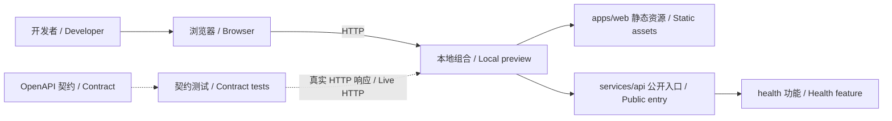
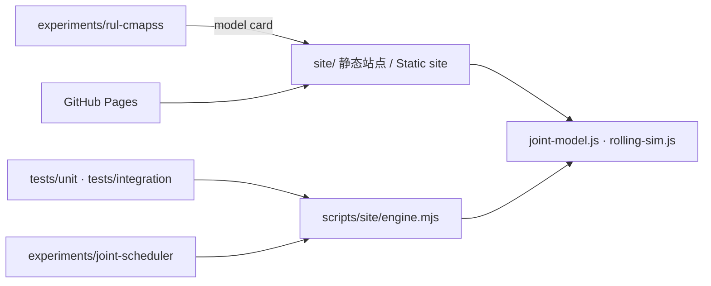

# 架构 / Architecture

## 决策与适用范围 / Decision and scope

采用 **npm workspaces 单仓库 + 按功能组织 + 模块化服务**。它让小团队能够在同一 PR 中协调前端、接口契约与后端改动。当前只有一个本地进程；业务模块可以在明确的部署需求出现后再独立部署。

Use an **npm workspaces monorepo with feature modules and a modular service**. A small team can coordinate UI, contracts and API changes in one PR. The current preview uses one local process; separate deployment can follow a demonstrated operational need.

这是一套适合当前阶段的工程选择，不能据此声称已具备生产系统的可用性或性能。选型记录见 [ADR 0001](decisions/0001-modular-monorepo.md)。

This is an engineering choice for the current stage, not evidence of production reliability or performance. See [ADR 0001](decisions/0001-modular-monorepo.md).

## 当前运行结构 / Current runtime

仅实现占位页面和 `/api/health`。没有数据库、业务身份系统、实际运营数据或已部署的云资源。

Only the starter page and `/api/health` are implemented. There is no database, business identity system, operational dataset or deployed cloud resource.

## 依赖方向 / Dependency direction

| 层或位置 / Location          | 职责 / Responsibility                                        | 约束 / Constraint                                         |
| ---------------------------- | ------------------------------------------------------------ | --------------------------------------------------------- |
| `apps/web/src/features/`     | 用户功能 / User-facing features                              | 通过 HTTP 访问服务 / Access services over HTTP            |
| `services/api/src/index.mjs` | 公开入口与路由组合 / Public entry and route composition      | 对外暴露稳定入口 / Expose a stable entry                  |
| `services/api/src/modules/`  | 各功能实现 / Feature implementation                          | 不依赖前端或启动脚本 / No web or startup dependency       |
| `packages/contracts/`        | HTTP 契约 / HTTP contracts                                   | 不依赖应用实现 / No application implementation dependency |
| `packages/shared/`           | 已出现复用需求的纯逻辑 / Proven reusable logic               | 不读取应用私有配置 / No application-private configuration |
| `scripts/preview/`           | 环境解析和本地运行组合 / Configuration and local composition | 可组合前端与公开 API / May compose web and public API     |

`npm run lint:architecture` 使用 dependency-cruiser 检查循环依赖、无法解析的导入、应用之间的越界引用、共享包反向依赖，以及绕过 API 公开入口的调用。前端新增 Node 包依赖时需要构建工具；当前预览直接提供浏览器 ES modules。

`npm run lint:architecture` uses dependency-cruiser to check cycles, unresolved imports, application boundaries, reverse package dependencies and bypasses of the API public entry. Browser dependencies that require package resolution need a bundler; the current preview serves native ES modules.

## 新增一个业务功能 / Adding a business feature

1. 先在 Issue 写出用户场景与验收标准。 / Define the journey and acceptance criteria in an Issue.
2. 在 `packages/contracts/openapi.json` 定义输入、输出和错误。 / Define requests, responses and errors in the OpenAPI contract.
3. 在 `services/api/src/modules/<feature>/` 实现，通过公开入口接入。 / Implement a service module and register it through the public entry.
4. 在 `apps/web/src/features/<feature>/` 实现交互、加载与失败状态。 / Implement UI, loading and failure states in a frontend feature.
5. 补齐契约与集成测试，更新演示路径。 / Add contract and integration tests; update the demo journey.

功能出现实际业务复杂度后，可以按 `domain/`、`application/`、`adapters/` 分层：领域逻辑不依赖 HTTP、数据库或外部 SDK，应用用例通过明确接口调用适配器。当前健康检查足够简单，保留单文件实现。

When a feature develops business complexity, introduce `domain/`, `application/` and `adapters/`: keep domain logic independent of HTTP, persistence and external SDKs, and connect use cases to adapters through explicit interfaces. The current health feature remains one small file.

## 演进条件 / Evolution triggers

| 需求信号 / Signal                                        | 后续动作 / Next step                                                                                             |
| -------------------------------------------------------- | ---------------------------------------------------------------------------------------------------------------- |
| 前端交互和依赖增加 / More UI complexity                  | 选定框架并补构建与浏览器测试 / Choose a framework, build and browser tests                                       |
| 需要存储真实业务状态 / Persistent business state         | 增加数据模型、迁移、存储适配器和回滚 / Add models, migrations, storage adapter and rollback                      |
| 需要对外部署 / External deployment                       | 增加身份权限、日志、运行检查和部署配置 / Add identity, authorization, logging, operational checks and deployment |
| 模块需要独立扩缩或发布 / Independent scaling or releases | 用指标和运营需求评估拆分 / Evaluate separation with operational evidence                                         |

## 参考与本项目采用方式 / References and adaptations

- [Turborepo repository structure](https://turborepo.dev/docs/crafting-your-repository/structuring-a-repository)：参考应用与共享包边界，当前使用 npm workspaces，未引入 Turbo 任务引擎。 / Apply workspace boundaries; use npm workspaces without the Turbo task engine.
- [Bulletproof React feature structure](https://github.com/alan2207/bulletproof-react/blob/master/docs/project-structure.md)：参考按功能组织，当前使用原生浏览器模块。 / Apply feature ownership using native browser modules.
- [OpenAPI 3.1.1](https://spec.openapis.org/oas/v3.1.1.html)：作为 HTTP 契约格式，健康响应通过 JSON Schema 验证。 / Use an HTTP contract with JSON Schema response validation.
- [C4 model](https://c4model.com/diagrams)：参考按读者需要表达系统边界；上图是本地运行示意图。 / Use audience-appropriate system views; the diagram above describes local execution.

这里记录的是团队对资料的适配选择，不表示这些项目对本仓库作出背书。 / These are team adaptations, not endorsements by the referenced projects.

## Demo 站点 / Demo site

`site/` 是独立的静态站点，不属于 npm workspaces。浏览器与 Node 共用同一份算法文件；`scripts/site/engine.mjs` 在 Node 中加载它们，供测试与复现使用。选型见 [ADR 0002](decisions/0002-static-demo-on-github-pages.md)。

`site/` is a standalone static site outside npm workspaces. Browser and Node share the same algorithm files; `scripts/site/engine.mjs` loads them in Node for tests and reproduction. See ADR 0002.

